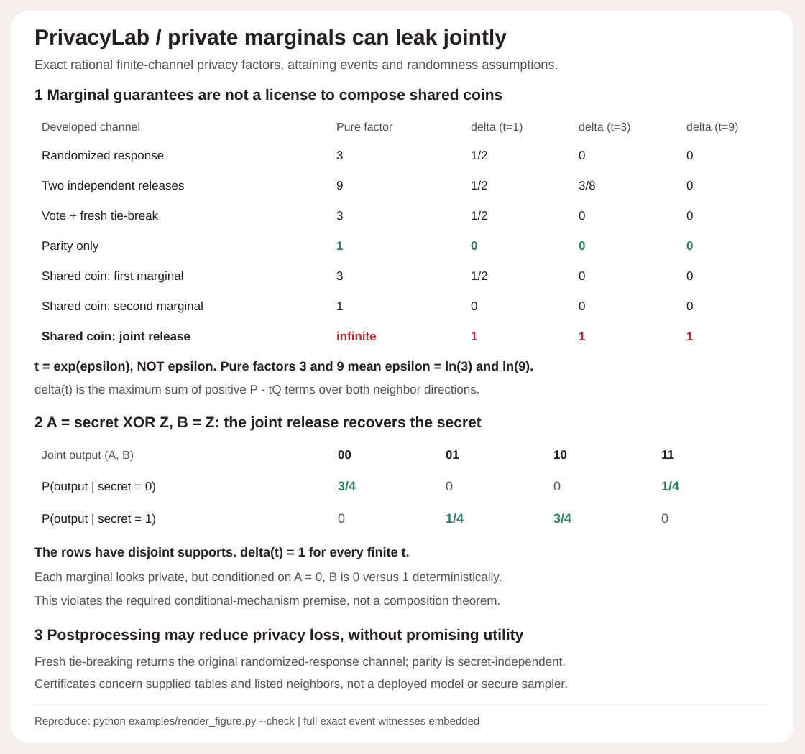
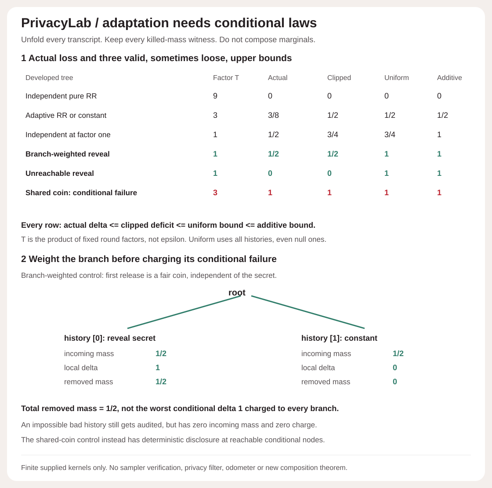
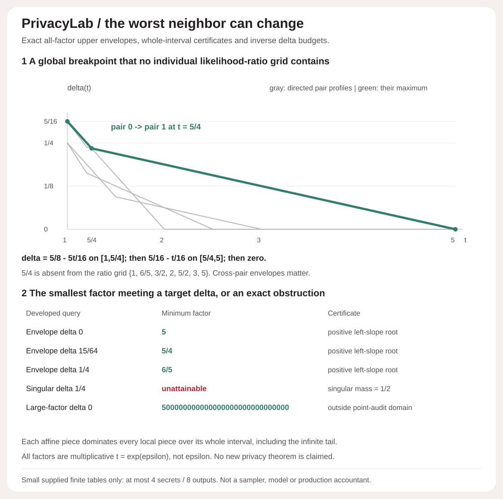

# PrivacyLab

An exact finite-channel differential-privacy reference. Supply rational probability tables and explicit neighboring-secret edges; inspect the smallest delta at a multiplicative privacy factor, every attaining event, and the complete directed-pair arithmetic. Independent product and stochastic postprocessing helpers make randomness assumptions visible.

**Private marginals can reveal a secret jointly.** In the developed shared-coin control, `A = secret XOR Z` and `B = Z`, with `P(Z=0)=3/4`. The first marginal has pure factor 3 and the second has factor 1, yet the joint output reveals `secret = A XOR B` exactly. Its two conditional distributions have disjoint supports and delta 1 at every finite factor. This does not contradict a composition theorem: the required conditional-mechanism premise is false.



## Run offline

Python 3.10+, standard library at runtime. No private datasets, credentials, network calls, paid APIs or random sampling.

```sh
python -m privacylab demo
python -m privacylab audit examples/input.json
python -m unittest discover -s tests -v
python examples/render_figure.py --check
python -m pip wheel --no-deps . -w dist
```

[Full exact demo report](examples/demo.json) · [caller input](examples/input.json) · [equations, assumptions and limits](DESIGN.md).

```python
from privacylab import audit, independent_product, postprocess

rr = {
    'schema_version': 1,
    'secrets': ['secret/0', 'secret/1'],
    'outputs': ['0', '1'],
    'neighbors': [[0, 1]],
    'probabilities': [['3/4', '1/4'], ['1/4', '3/4']],
}
assert audit(rr, '3')['delta'] == '0'
assert audit(rr, '3')['pure_factor'] == '3'

joint = independent_product(rr, rr)['channel']
assert audit(joint, '3')['delta'] == '3/8'
assert audit(joint, '9')['delta'] == '0'
```

## Factor is not epsilon

The API accepts an exact rational factor `t = exp(epsilon) >= 1`, not epsilon itself. Factor 3 means epsilon `ln(3)`; factor 9 means epsilon `ln(9)`. No approximate exponential or logarithm participates in a decision.

For each listed undirected neighbor edge, inspect **both directions** `P,Q`. At factor `t`, the smallest valid slack for that pair is

```text
delta_pair(t) = max_event [P(event) - t Q(event)]
              = sum_output max(P(output) - t Q(output), 0)
```

The report's delta is the maximum over all directed neighbor pairs. It retains every signed/positive excess, P/Q ratio or support-mismatch status, the canonical strict-positive attaining event and its P/Q masses, zero-excess ties, singular mass, every worst pair, and the minimal pure factor with output-level witnesses when finite. `pure_factor = null` is explicitly tagged infinite due to support mismatch, never mistaken for no data or zero privacy loss. Unlisted secret pairs remain visible; the audit says nothing about their adjacency.

## Developed controls

All numbers below are exact for small supplied channels, not empirical privacy measurements.

| Channel | Minimal pure factor | delta at factor 1 | delta at factor 3 | delta at factor 9 |
| --- | --- | --- | --- | --- |
| Randomized response, truthful probability 3/4 | 3 | 1/2 | 0 | 0 |
| Two independent randomized-response releases | 9 | 1/2 | 3/8 | 0 |
| Joint release postprocessed by vote with a fresh fair tie-break | 3 | 1/2 | 0 | 0 |
| Only the parity of two independent releases | 1 | 0 | 0 | 0 |
| Shared coin, first marginal | 3 | 1/2 | 0 | 0 |
| Shared coin, second marginal | 1 | 0 | 0 | 0 |
| Shared coin, joint release | infinite | 1 | 1 | 1 |

The stochastic vote is exactly the original randomized-response channel. Parity is secret-independent with distribution `[5/8,3/8]`; more privacy is not a utility claim. Conditioning the shared-coin example on `A=0` makes B deterministic 0 versus 1, explicitly showing why the second release does not satisfy the required conditional privacy premise. The independent-product helper cannot validate independence in an external implementation; it constructs the product table **under that assumption**. Postprocessing uses one supplied secret-independent row-stochastic kernel for every secret, with fresh kernel randomness. Feeding in extra secret information or reusing correlated coins is outside that contract.

## Strict inputs and limits

- Channels have exactly `schema_version` (integer 1), `secrets`, `outputs`, `neighbors`, `probabilities`. API accepts lists/tuples for arrays; JSON uses arrays.
- Between 2 and 8 secrets, 1..64 outputs, 1..28 undirected edges. Both edge directions are audited. Self edges, duplicate undirected edges, invalid indices and empty graphs are rejected. Helpers require identical ordered secrets and canonical neighbor edges.
- Unique ASCII labels are 1..40 characters using letters, digits, spaces and `_.:/-`. Labels are identifiers, not private-data discovery requests.
- Probabilities are integers, exact decimal/fraction strings or API `Fraction` values. Floats and booleans are rejected. Rows must sum **exactly** to 1; no clipping, renormalization or tolerance. Fraction syntax is unsigned, with a positive denominator; no exponent notation or surrounding whitespace. Each rational numerator/denominator is limited to 512 bits; strings to 160 characters. Computed transform outputs must also satisfy that limit, or the helper fails explicitly.
- Factors are exact rationals in `[1,10^12]`. The original audit reports are point queries, not interpolated curves or adaptive stopping rules; the smaller-domain frontier extension below has separate full-curve semantics.
- The strict audit CLI wrapper has exactly `schema_version` (integer 1), `channel`, `factor`. Input cap 100000 bytes; duplicate/unknown/missing keys, nonfinite JSON, bad UTF-8 and invalid values fail with exit 2 and empty stdout.

## Original static-channel verification

The original 29 tests: 14 core probability/audit tests, 9 transform tests, 3 CLI tests and 3 SVG tests. Twenty-four seeded three-secret/four-output channels are checked against exhaustive enumeration of all 16 events per directed pair at four exact factors. Every demo term/event/support field is reconstructed. Tests also cover a `10^-100` singular leak retained exactly, minimal pure-factor witnesses, factor monotonicity/convexity, adjacency omissions, permutations, exact decimal parsing, full 8-secret/64-output capacity, strict validation and nonmutation/RNG state.

Transform tests reconstruct every product probability/mapping; compare repeated randomized response through four releases with exact binomial count channels; test 24 seeded stochastic postprocessing contractions; verify shared-coin reconstruction and its conditional failure; and cover identity/constant/permutation kernels, alignment, output capacity and computed rational limits. SVG checks verify all 36 exact cells and their coordinates, full compressed JSON metadata, a hidden attaining-event tamper, and byte-exact regeneration. The original five-module wheel reproduced both complete CLI JSON outputs outside checkout. Version 0.2 wheel and CI coverage are described below.

## What this does not certify

A table certificate applies to the supplied finite mechanism and listed neighbor graph only. It does not prove that a program samples that table, that randomness is secure/fresh/independent, that a neighboring-dataset relation covers a real application, or that unlisted possible inputs are protected. No trained-model guarantee, DP-SGD accountant, continuous Gaussian mechanism, privacy-loss convolution, advanced composition, adaptively chosen privacy parameters, privacy-utility optimum or production security claim. A low delta is not a probability that any particular person's secret leaks, and differential privacy does not promise that useful population facts remain hidden.

This implements established finite-distribution DP and hockey-stick divergence arithmetic, not a new privacy theorem. Primary references: Dwork and Roth's [Algorithmic Foundations of Differential Privacy](https://homepage.divms.uiowa.edu/~sriram/5980/spring17/privacybook.pdf), definition 2.4 and proposition 2.1; [modern privacy accounting notes](https://arxiv.org/pdf/2210.00597), proposition 7 and theorem 9; and Google Research's [privacy accounting overview](https://research.google/blog/differential-privacy-accounting-by-connecting-the-dots/). See [DESIGN.md](DESIGN.md) for the finite proof and implementation boundaries.

## Exact adaptive transcript extension

Version 0.2 adds `adaptive(tree, factors)` and two CLI commands. Each conditional node supplies the full next-output distribution **given the secret and entire prior transcript**, not an unconditional marginal. Factors are fixed per round, independent of history. Every possible history is required, including histories with zero probability under every secret.



```sh
python -m privacylab adaptive-demo
python -m privacylab adaptive examples/adaptive-input.json
python examples/render_adaptive.py --check
```

The implementation unfolds the exact transcript channel, audits every conditional kernel, and constructs a directional clipped subdistribution. For directed secrets P,Q, each local kernel becomes `min(K_P, t_i*K_Q)` without normalization. Multiplying those subkernels along the tree gives leaf mass `g` with `g <= P` and `g <= T*Q`, where `T=product(t_i)`. Thus the actual joint delta at T is at most `1-sum(g)`. Every incoming mass, clipped kernel, removed mass, per-round loss and leaf domination slack is retained. The maximum directional deficit is compared with uniform per-round survival and clamped additive bounds. [The proof and exact input contract](ADAPTIVE.md) distinguish these bounds from the actual profile.

| Developed two-round tree | Product factor T | Actual delta | Clipped bound | Uniform bound | Additive bound |
|---|---:|---:|---:|---:|---:|
| Independent pure randomized response | 9 | 0 | 0 | 0 | 0 |
| Adaptive randomized response or constant | 3 | 3/8 | 1/2 | 1/2 | 1/2 |
| Independent response at factor one | 1 | 1/2 | 3/4 | 3/4 | 1 |
| Fair branch, reveal on one side | 1 | 1/2 | 1/2 | 1 | 1 |
| Reveal only on an impossible history | 1 | 0 | 0 | 1 | 1 |
| Shared coin, actual conditional laws | 3 | 1 | 1 | 1 | 1 |

The fair-branch control charges a local delta of 1 to incoming mass 1/2, so removed mass is 1/2. An impossible revealing node is still audited, but contributes zero killed mass. The shared-coin control has revealing conditional laws on reachable histories, so no marginal-composition shortcut passes. A strict gap between actual delta and a bound is shown, not hidden.

46 tests now include the original 29, 14 adaptive behavior tests and three adaptive SVG tests. Twenty-four seeded three-round, three-secret trees are checked against recursive path enumeration and exhaustive all-256-event searches per directed pair. Tests reconstruct all conditional events, flow conservation and leaf inequalities; exercise six rounds, 64 transcripts, eight secrets and all 28 edges; check secret/output permutations, null histories, omitted adjacency, unary rounds, exact tiny mass, invalid input and computed-rational limits. Both figures regenerate byte-exactly. The six-module installed wheel matches all four complete CLI JSON outputs outside checkout.

This is finite supplied-kernel analysis, not verification that an external program uses those conditional laws. Limits are six rounds, eight outcomes per round, 64 transcripts, 128 conditional nodes and 512-bit constructed probability/flow components. Canonical output fractions can be longer than the 160-character input-string cap; use API `Fraction` values to resubmit those exact values. There is no unbounded interaction, adaptive parameter selection, stopping-time filter, privacy odometer, advanced composition or optimal-composition implementation. Existing DP composition and subdistribution reasoning are credited, not claimed as new: see [Dwork and Roth, section 3.5](https://homepage.divms.uiowa.edu/~sriram/5980/spring17/privacybook.pdf) and [fully adaptive composition context](https://arxiv.org/html/2203.05481v3). This extension does not implement that paper's filters or odometers.

## Exact factor-frontier extension

Version 0.3 adds `frontier(channel)` and `minimum_factor(channel, target_delta)`. For small supplied tables, it computes the **complete worst-directed-neighbor profile for every finite factor t >= 1**, not an interpolation between point queries. The new frontier domain is at most four secrets and eight outputs; the original point-audit and adaptive-tree domains are unchanged.



```sh
python -m privacylab frontier-demo
python -m privacylab frontier examples/frontier-input.json
python examples/render_frontier.py --check
```

A directed pair has profile `sum(max(P-tQ,0))`, affine between its likelihood-ratio knots. The global profile is the upper envelope over all listed directions. **Pair profiles can cross between ratio knots.** The implementation considers those intersections, then certifies every complete global affine interval against every overlapping local piece using endpoint slacks and an infinite-tail slope check. Reports retain each local event set, local/global coefficients, interval boundaries, whole-interval domination witnesses, exact knot events/ties, singular plateau, pure factor and omitted neighbor pairs.

The developed three-secret/four-output control has rows `[1/16,5/16,1/8,1/2]`, `[5/16,3/8,1/16,1/4]`, `[1/8,5/16,3/16,3/8]` and listed edges 0-1,1-2. Its global profile is:

| Factor interval | Exact delta(t) | Interior maximizing direction |
|---|---|---|
| 1 to 5/4 | 5/8 - 5t/16 | secret 0 to secret 1 |
| 5/4 to 5 | 5/16 - t/16 | secret 1 to secret 0 |
| 5 onward | 0 | every listed direction |

The switch at **5/4 is absent** from the individual ratio grid `{1,6/5,3/2,2,5/2,3,5}`. Target delta 1/4 needs minimum factor 6/5; target 15/64 needs 5/4; target zero needs 5. Inverse results retain actual attaining events plus either the domain lower bound t=1 or a positive-left-slope root certifying minimality. A target below a singular-support plateau is explicitly unattainable, with a zero-Q event obstruction. Another control has minimum pure factor `5*10^29`, reported exactly and flagged outside the original point-audit numeric domain. It is not silently clipped to 10^12.

63 tests retain all previous 46 and add 14 frontier behavior plus three SVG tests. Thirty-two seeded four-output channels use exhaustive all-16-event references at endpoints and multiple interior/tail factors, with inverse checks at four targets. Tests reconstruct every interval-domination overlap, continuity and convex slopes; check the non-ratio crossing, singular plateau/equality attainment, tiny exact mass, large factors, full four-secret/eight-output/six-edge capacity including a dense rational table, all-zero-support cases, permutations, omitted edges and strict input/CLI errors. All ten new query cells, global vertices and every directed-curve vertex are checked, alongside complete report metadata, hidden domination-witness tampering and byte-exact SVG regeneration. All three figures regenerate exactly; the seven-module wheel matches all six complete CLI JSON outputs outside checkout.

[Full frontier proof and contract](FRONTIER.md). These are exact small finite-table profiles, not optimal composition over unknown mechanisms, privacy-loss convolution, private training or deployed-program certification. The frontier uses established hockey-stick mathematics and finite affine-envelope reasoning, not a new privacy theorem. [Google Research's accounting overview](https://research.google/blog/differential-privacy-accounting-by-connecting-the-dots/) explains the discrete piecewise-linear connection; this repository does not implement its Connect-the-Dots discretization or a production accountant. Whole-frontier analysis does not expand the original point-audit factor cap or make the adaptive clipping bound an exact optimal-composition profile.
